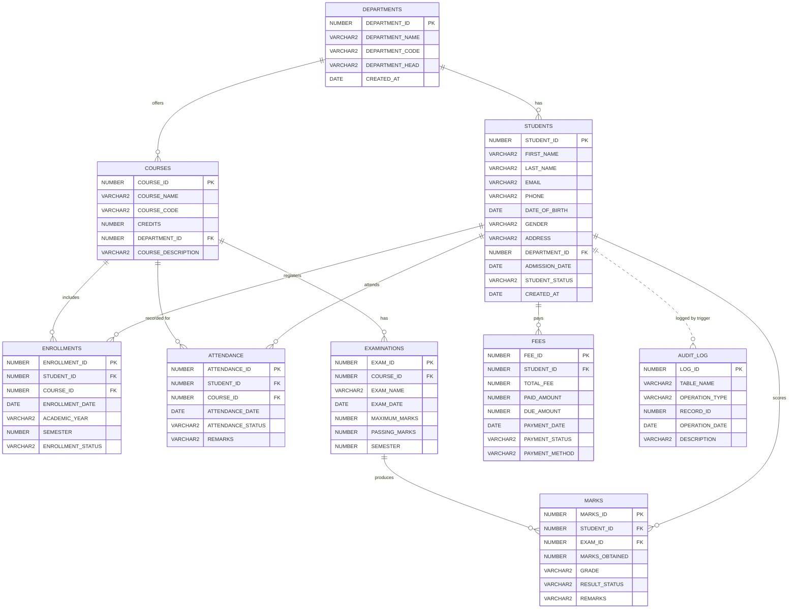

# ER Diagram — Student Management System (SMS)

## Mermaid ER diagram

> In the diagram `||--o{` means **one-to-many** (optional many). The `||..o{` link to
> `AUDIT_LOG` is a **logical** link only — AUDIT_LOG.`RECORD_ID` stores the student id but
> there is **no foreign key**, because audit history must survive even if a student row is
> removed.

---

## Relationships in plain English

Every relationship below shows the cardinality, the foreign key that implements it in
`01_create_tables.sql`, and an example taken from the sample data in
`03_insert_sample_data.sql`.

### 1. One department has many students

- **Cardinality:** 1 : N (one department → many students).
- **Foreign key:** `fk_stu_dept` — STUDENTS.DEPARTMENT_ID → DEPARTMENTS.DEPARTMENT_ID.
- **Example:** Department 1 (Computer Science) has five students: 1 Aarav Sharma, 2 Diya
  Patel, 3 Vivaan Reddy, 4 Ananya Iyer and 5 Arjun Nair (all rows with DEPARTMENT_ID = 1).

### 2. One department offers many courses

- **Cardinality:** 1 : N.
- **Foreign key:** `fk_course_dept` — COURSES.DEPARTMENT_ID → DEPARTMENTS.DEPARTMENT_ID.
- **Example:** Department 1 (Computer Science) offers courses 1 (CS101 Data Structures),
  2 (CS102 Database Management Systems) and 3 (CS103 Operating Systems).

### 3. One student enrolls in many courses (resolved by ENROLLMENTS)

- **Cardinality:** M : N between STUDENTS and COURSES, resolved by the ENROLLMENTS junction
  table into two 1 : N links.
- **Foreign keys:** `fk_enr_student` (ENROLLMENTS.STUDENT_ID → STUDENTS) and
  `fk_enr_course` (ENROLLMENTS.COURSE_ID → COURSES).
- **Example:** Student 1 (Aarav Sharma) is enrolled in course 1 and course 2 — enrollment
  rows 1 and 2. This is the many-to-many relationship made concrete.

### 4. One course has many students

- **Cardinality:** 1 : N (one course → many students, seen through ENROLLMENTS).
- **Foreign key:** `fk_enr_course` — ENROLLMENTS.COURSE_ID → COURSES.COURSE_ID.
- **Example:** Course 1 (Data Structures) has students 1, 2 and 4 — enrollment rows 1, 3 and 6.

### 5. One course has many examinations

- **Cardinality:** 1 : N.
- **Foreign key:** `fk_exam_course` — EXAMINATIONS.COURSE_ID → COURSES.COURSE_ID.
- **Example:** Course 1 (Data Structures) has two examinations: exam 1 ("Data Structures
  Mid-Term") and exam 2 ("Data Structures Final").

### 6. One student has many attendance records

- **Cardinality:** 1 : N.
- **Foreign key:** `fk_att_student` — ATTENDANCE.STUDENT_ID → STUDENTS.STUDENT_ID.
- **Example:** Student 1 (Aarav Sharma) has eight attendance rows in course 1 (attendance
  ids 1–8: 7 Present + 1 Absent = 87.5 %).

### 7. One student has many examination results

- **Cardinality:** 1 : N.
- **Foreign key:** `fk_mark_student` — MARKS.STUDENT_ID → STUDENTS.STUDENT_ID.
- **Example:** Student 1 (Aarav Sharma) has three marks rows: exam 1 (82), exam 2 (88) and
  exam 3 (91) — marks ids 1, 4 and 7.

### 8. One student has many fee records

- **Cardinality:** 1 : N.
- **Foreign key:** `fk_fee_student` — FEES.STUDENT_ID → STUDENTS.STUDENT_ID.
- **Example:** In the sample data each student has one fee account; student 1 (Aarav Sharma)
  has fee account 1 with TOTAL_FEE 50000, PAID_AMOUNT 50000 and DUE_AMOUNT 0. Because the
  relationship is 1 : N, a student *could* have more than one account over time (the
  RECORD_FEE_PAYMENT procedure picks the latest account by `ORDER BY fee_id DESC`).

---

## Many-to-many relationship and the ENROLLMENTS junction table

A student can take **many** courses, and a course can be taken by **many** students. A
relational table cannot hold "many" values in a single column, so the relationship is
**resolved by a junction (bridge) table, ENROLLMENTS**. Each row of ENROLLMENTS represents
one registration: a `STUDENT_ID` + a `COURSE_ID` (+ the academic year and semester).

ENROLLMENTS has two foreign keys (`fk_enr_student`, `fk_enr_course`) that point back to the
two parent tables, and its primary key (`pk_enrollments`) uniquely identifies each
registration. This design is exactly why student 1 can appear in two enrollment rows while
course 1 also appears in several enrollment rows.

**What `uq_enrollment` prevents:** the unique constraint
`UNIQUE (STUDENT_ID, COURSE_ID, ACADEMIC_YEAR, SEMESTER)` stops the **same student being
registered twice in the same course for the same academic year and semester**. Without it,
duplicate enrollment rows could inflate attendance and result reports. The
`ENROLL_STUDENT` procedure checks for this duplicate first and raises a friendly
`e_duplicate_enrollment` error, and the constraint is the final safety net if the check is
bypassed.
